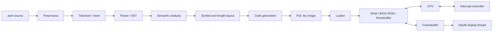
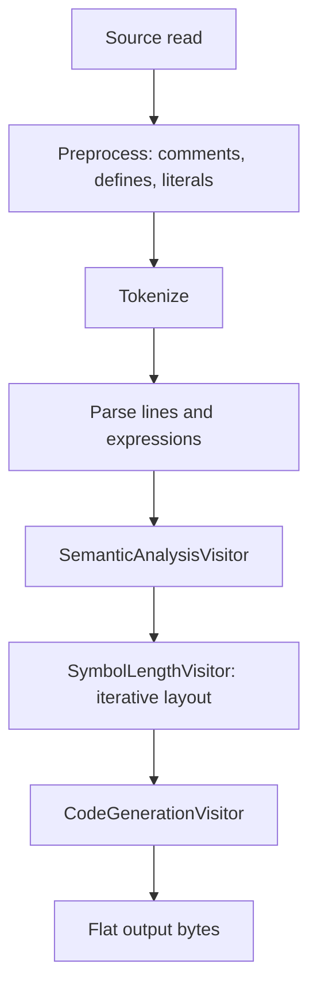

# C_VM_PROJECT — Agent Context

This document is a source-oriented guide for agents and future sessions. It summarizes the project architecture, runtime, ISA, assembler, custom assembly language, BIOS, and noteworthy implementation constraints. Treat implementation as authoritative when it differs from a prose document.

## Project at a glance

The repository contains two programs:

- **VM (`vm/`)**: a C virtual machine with a custom 32-bit CPU, memory map, interrupt controller, keyboard/platform layer, and Raylib framebuffer display.
- **Assembler (`assembler/`)**: a C++17 assembler and disassembler for the VM's custom assembly format.
- **Shared ISA (`shared/ISA_encoding_info.h`)**: opcode and operand encoding definitions included by both the assembler and VM.

Other important root files:

| Path | Purpose |
|---|---|
| `encoding.txt` | Human-readable instruction encoding description and examples |
| `asmgrammar.txt` | Assembly grammar reference |
| `semantic rules.txt` | Assembly semantic constraints |
| `config.vconf` | VM memory, clock, BIOS, entrypoint, display, and timer configuration |
| `bios.asm` | BIOS assembly source |
| `bios.tky` | BIOS image consumed by the current config |
| `bios_dis.asm`, `bios_symbols.txt` | Disassembly and symbol-list artifacts; may represent a different BIOS build |
| `Makefile` | VM and assembler build targets; no explicit BIOS assembly target was found |
| `make_bios_rom.py` | Writes a 0xFFFF-byte image filled with `0x01`; does not assemble BIOS source |

## Architecture and data flow



The assembler is under `assembler/headers` and `assembler/srcs`. Its main stages are in `assembler/srcs/LexicalAnalyzer`, `assembler/srcs/Parser`, and `assembler/srcs/Parser/Visitors`. The VM's CPU, memory, and VM integration are under `vm/srcs/CPU`, `vm/srcs/Memory`, and `vm/srcs/VM`; public interfaces are in `vm/headers`.

## VM initialization and execution

### Initialization

The normal VM initialization path is:

1. `launch.c` or the shell reads `config.vconf` via `vm_get_settings` and applies it with `vm_set_settings`.
2. `vm_init` creates/resets the CPU and instruction dispatch table.
3. It allocates RAM, BIOS ROM, and framebuffer via `mem_init`.
4. It loads the configured BIOS image into ROM using `load_BIOS_img`.
5. It initializes the interrupt controller and starts the Raylib display update thread.
6. `vm_boot_sequence` sets `PC` to the configured entrypoint, marks the CPU running, and calls `CPU_run`.

`vm_init_nomem` exists as a CPU-only initialization path. `vm_runf` loads an executable containing 33 bytes of metadata, whereas `vm_load_binary_file` loads a flat image into RAM at an explicit address. The BIOS image is loaded separately into ROM.

### Memory map

| Region | Address / size | Notes |
|---|---|---|
| RAM | Configured size; defaults to 10 MiB | General RAM access |
| BIOS ROM | `0xF9C00000`–`0xF9C0FFFF` | Normal memory dispatch reads it and disallows writes |
| Framebuffer | Starts `0xF9D10000`, size `0x500000` | Mutex-protected reads/writes; displayed by another thread |

Memory helper functions read and write multi-byte values in **big-endian** order. Review bounds checks before changing them: RAM and BIOS validity predicates use `addr <= size`, even though a byte array's highest valid index is normally `size - 1`. BIOS constants also define `BIOS_SIZE` as `0xFFFF` while the inclusive documented address interval contains `0x10000` bytes.

### Fetch/decode/execute and PC behavior

`CPU_run` repeatedly reads the opcode at `PC`, dispatches through a 256-entry function table, then checks for a pending enabled interrupt. Operand-bearing handlers call CPU helpers to read the operand-type byte and conditionally read register selectors, memory metadata, displacement, immediate, and symbol bytes. `CPU_exec_ins` advances `PC` after the handler and increments the cycle counter. `CPU_step` also applies configured per-cycle delay.

The PC convention is important: during an instruction, `PC` points at the opcode; operand reads advance it. The execution loop performs a final increment after the handler. Branch/call helpers therefore set `PC` to `target - 1`, allowing that final increment to land on the target. Interrupt return and hardware-interrupt handling include extra compensation for the same convention. Preserve this model consistently when changing instruction handlers.

When `hlt` is executed, the CPU loop simulates cycles until a configured wakeup interrupt clears the halted state. The interrupt line is serviced only when the CPU interrupt-enable flag is set. Interrupt entry pushes return PC, CS, and CPU state flags, then loads the handler address from `IVTR + vector * 4`. `iret` pops those values back.

### Registers and flags

The register file is a C union exposing byte, 16-bit word, and 32-bit dword views. It contains six general-purpose register groups `A` through `F`, plus `PC`, `SI`, `DI`, `SP`, `BP`, `CS`, `SS`, `DS`, and `IVTR`. The assembly aliases include low/high byte names (`al`/`ah`), 16-bit names (`ax`), and 32-bit names (`eax`); equivalent groups exist for B–F. Arithmetic/control flags are zero, negative, carry, overflow, interrupt-enable, and trace.

## ISA and binary encoding

The opcode list is in `shared/ISA_encoding_info.h`; `assembler/srcs/ArchInfo.cpp` maps assembly mnemonics to opcode bytes, including the alias `mov` for `set`. The ISA includes data movement, arithmetic, bitwise operations, comparisons, stack operations, conditional branches and calls, flag set/clear operations, interrupts, string/output operations, and halt.

Operand-bearing instruction bytes generally follow this shape:

```text
opcode
[operand types]
[register selectors]
[memory descriptor]
[signed 32-bit displacement]
[immediate]
[32-bit symbol/address]
```

- Operand-type byte: source (3 bits), destination (3 bits), memory scale (2 bits).
- Operand types distinguish 8/16/32-bit registers and memory, number, and unknown/symbol.
- Register selector byte is present if either operand is a register.
- Memory descriptor records address-register presence, displacement presence, a 3-bit index, and a 3-bit base.
- Address expression: `base + (index * scale) + displacement`.
- Legal scale values: 1, 2, or 4. At most one base and one index register are accepted.
- Multi-byte encoded values are big-endian. Displacements are signed 32-bit; symbols are 32-bit.
- One-operand immediates occupy 32 bits. In two-operand instructions, immediate width follows the destination width. The source cannot be wider than the destination when both widths are explicit.

The ISA is intentionally custom despite its x86-like register names and memory addressing syntax. It has six general-purpose register groups, including `EEX` and `EFX`, and a custom opcode/interrupt model. Do not assume x86 machine-code compatibility.

Several declared opcodes have empty or incomplete C handlers at the time of inspection: `_cti`, `_len`, `_str`, `_inps`, `_lenw`, and `_end`. The opcode list therefore represents more functionality than the runtime currently implements.

## Assembler pipeline

`Assembler::assembleSource` reads source, strips an optional UTF-8 BOM, preprocesses and tokenizes it, parses to AST, runs `AssemblerPipeline`, checks the optional maximum image size, then writes the flat image.



`AsmContext` carries symbols, section/program offsets, per-node addresses and lengths, and generated bytes through all visitors. Semantic analysis checks instruction arity, operand combinations and sizes, and decomposes memory expressions. The layout visitor iterates up to 32 passes for forward/symbol-dependent layout, then runs a final pass with unresolved symbols disallowed. Code generation emits the final bytes and fills `org` gaps with zeroes. The output starts at the first emitted address; it does not prepend bytes from address zero to the `org` address.

The assembler CLI also supports listings, symbol maps, `--max`, external/inline symbol definitions, and binary disassembly. Flat binaries do not store their `org` base; disassembly infers it from absolute control-flow targets where possible or accepts `--base`.

## Custom assembly language rules

The language is line-oriented. It supports:

- Instructions with zero, one, or two comma-separated operands.
- Labels/declarations, `equ`, `org`, `section`, and `times`.
- Data: `defb`, `defw`, `defdw`; reserved storage: `resb`, `resw`, `resdw`.
- Sized memory operands: `byte[...]`, `word[...]`, `dword[...]`; unsized memory defaults to dword.
- Arithmetic expressions with unary `+`/`-`, `*`, `/`, `+`, and `-`, with conventional multiplication-before-addition precedence.
- `$` for program offset and `$$` for section offset.
- Quoted strings in data declarations; strings emit one Unicode code point per element at the directive width.
- Semicolon comments and `define NAME value` macro declarations.

Registers are not allowed in ordinary arithmetic expressions. In memory expressions, registers must be permitted base/index terms; a register cannot be subtracted. Only one displacement expression is effectively supported by the encoding. A direct symbol cannot be an instruction destination; use sized memory syntax for a memory destination. Instructions support at most one memory operand, at most one direct symbol, and at most one immediate expression.

Implementation/documentation discrepancy: source preprocessing converts hexadecimal and binary literals (and single-character literals) into decimal text. The tokenizer then recognizes decimal digits. The assembler README documents octal forms for external `--define` values, but source-level octal literal support was not evident in the preprocessor/tokenizer.

## BIOS source and status

`bios.asm` sets `org 0xF9C00000`, defines BIOS constants and memory regions, initializes a stack, installs IVT entries, prints startup messages, enables interrupts, halts, calls a bootloader at `0x2800`, then prints a finish message and executes `ext` if control returns. BIOS helpers include string printing, pixel/character drawing, alphabetic and case conversion, string length, and integer parsing. BIOS interrupt sections include exception handlers, IO and disk dispatch, a test interrupt, a timer tick, and an invalid-interrupt handler. The data section includes cursor state, keyboard/text buffer pointers, messages, font glyphs, and an ASCII glyph map.

Known incomplete areas/dependencies:

- `chrout` and `chrin` return immediately.
- Disk services `dskstat` and `rdsect` return immediately.
- Many IVT slots are zero.
- The source calls a bootloader at `0x2800`; no bootloader source was found in the repository listing.
- Some referenced ISA operations have empty C handlers (see above).
- `make_bios_rom.py` creates a 0xFFFF-byte `0x01` filler image; it does not assemble `bios.asm`.
- The Makefile has no explicit BIOS assembly target.
- At inspection, `bios.tky` was 5,252 bytes, while `bios_dis.asm` showed different opening code and symbol addresses from the current `bios.asm`; the relationship among these generated artifacts is therefore unclear.

Treat the BIOS assembly source as a partially implemented BIOS, and verify which binary is intended for boot before relying on runtime behavior.

## Noteworthy design decisions and cautions

- **Shared opcode source:** the VM and assembler include the same opcode/encoding header, helping avoid opcode-number drift.
- **Custom ISA with familiar syntax:** x86-like names/addressing are used without x86 compatibility; keep that distinction explicit.
- **Big-endian architecture:** assembler emission and VM memory helpers agree on big-endian values.
- **Variable-length instructions:** compact encodings depend on assembler/VM agreement about optional metadata bytes.
- **Iterative assembler layout:** supports forward references and symbol-dependent addresses before generation.
- **PC compensation convention:** `target - 1` is part of the execution model and affects branches, calls, and interrupts.
- **BIOS build reproducibility:** source, image, disassembly, symbol map, and Makefile do not currently establish one obvious reproducible build chain.
- **Potential boundary issue:** RAM/ROM address validity includes `size`; review before modifying memory access.
- **Display/VM coupling:** `vm_init` creates a GUI display thread, so initialization is not purely headless even though console/shell paths exist.

## Workspace inspection note

At the time this context was prepared (2026-11-05), `git status --short` showed `bios.asm` and `bios.tky` as modified. Those were pre-existing workspace changes and were not altered while creating this document. Inspect their diffs before treating them as the repository baseline.

No builds, tests, or execution were performed for this report; it is based on source inspection.
